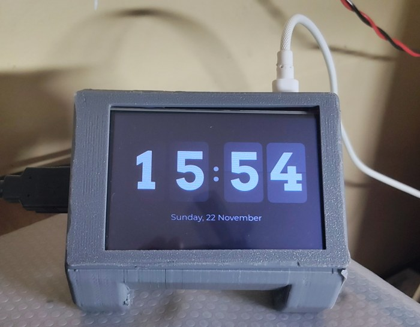
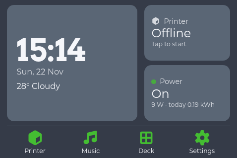
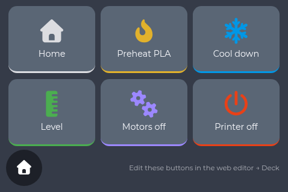
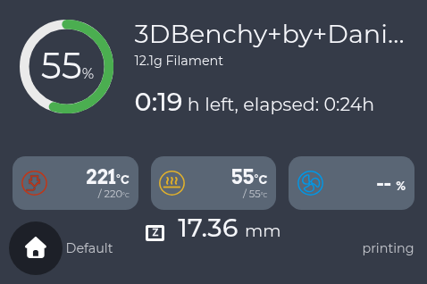
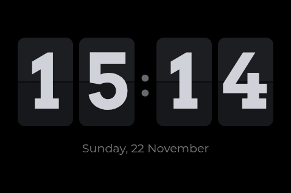

My 3D printer's touchscreen did nothing most of the time. So I made it do something.

The 3.5 inch screen next to my printer only mattered while printing, and even then there was rarely anything to tap. The rest of the day it showed an error or a sleeping logo. **Companion** turns it into a CarPlay-style home screen for the printer. The printer controls are still there, as one app among others.

What it does
======

- **Dashboard:** clock, weather, print progress and live power draw (watts and kWh per print from a TP-Link Tapo P110 plug).
- **Music:** Spotify remote with the album cover as a live poster, synced lyrics, playlists and queue.
- **Deck:** custom shortcut buttons for G-code, plug on/off and Home Assistant webhooks.
- **Print from off:** pick a file and tap Print while the printer is off. The plug switches on, OctoPrint connects and the print starts. Two minutes after the print ends, the printer turns itself off.
- **Night clock:** a flip clock after 5 minutes without a tap.
- **Web editor:** the same app at the printer's address, to set everything up from a laptop or phone, also remotely over Tailscale.
- **Timelapse watermark:** my own logo on every timelapse instead of the OctoPrint default.

  
  
  
  
  

What I learned
======

- **Cheap resistive SPI touchscreens are hard.** The stock overlay drops nearly every tap on current kernels. The fix was a single active-low flag on the pen-down GPIO pin.
- **Tap-only beats swipes on a resistive screen.** Every list pages with ◀ ▶ buttons, and anything risky needs two taps, PLC-style.
- **A Raspberry Pi 3 runs Electron and Angular fine** if animations stay cheap, since there is no GPU acceleration on the SPI framebuffer.
- **OAuth without HTTPS needs workarounds.** Spotify requires an HTTPS redirect, so the login goes through Tailscale's HTTPS address and the token exchange happens on the OctoPrint plugin side.

Stack
======

Raspberry Pi 3B+, OctoPrint, Angular, Electron, Python (OctoPrint plugins), built on the open-source [OctoDash](https://github.com/UnchartedBull/OctoDash) project.

Source
======

- [Companion](https://github.com/sudo-atharva/companion) (setup guide and screenshots in the repo)
- [OctoPrint PSU Control - Tapo](https://github.com/sudo-atharva/OctoPrint-PSUControl-Tapo)
- [OctoPrint Timelapse Watermark](https://github.com/sudo-atharva/OctoPrint-TimelapseWatermark)
